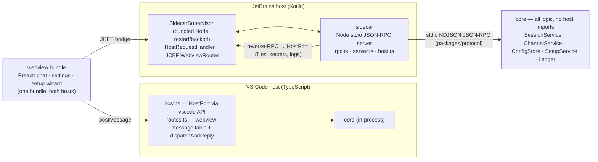
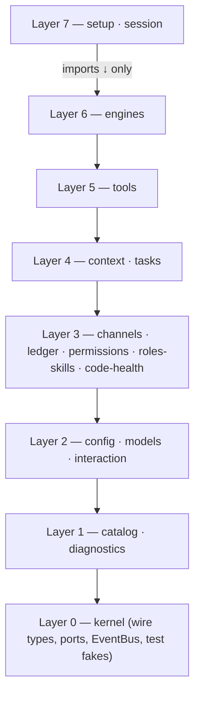
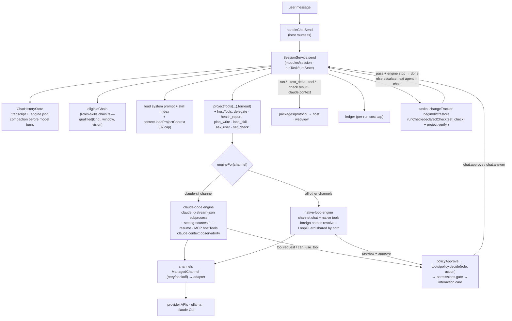
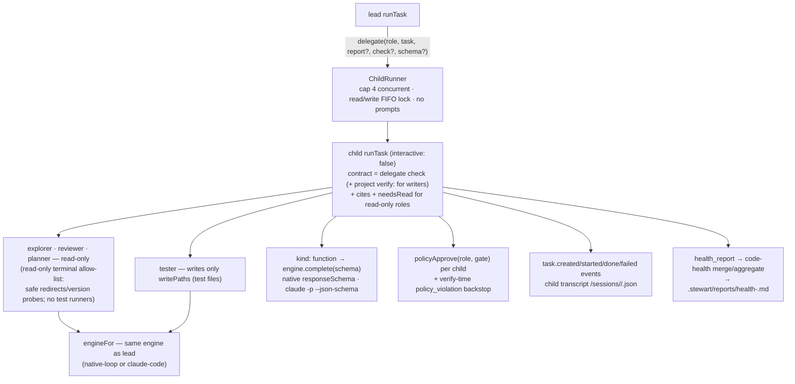

# Stewart — Architecture Diagrams

Rendered view of the code as built (v3.0.4). Prose source of truth: [`docs/ai_docs/ARCHITECTURE_NOW.md`](ai_docs/ARCHITECTURE_NOW.md). Update both in the same commit when modules, run paths, protocol, config or host wiring change.

## 1. Repo layout & runtime topology

```
packages/   protocol · core · sidecar · webview · evals (own suite + SWE-bench Docker runner)
modules/    17 × @stewart/<module> (strict layers, scripts/layers.json)
hosts/      vscode (TS, in-process core) · jetbrains (Kotlin + sidecar)
```



One chat path exists: the **lead session**. Every request flows `webview → host → (in-process | sidecar) → Core.dispatch → SessionService`.

Evals are host-free: the own suite runs tasks over a real `Core` + `nodeHost`; the SWE-bench runner lets the lead edit a host checkout of each official image's `/testbed`, then scores the `git diff` in a fresh container.

## 2. Module layers

17 `@stewart/<module>` packages; a module imports **only strictly lower layers** (`scripts/layers.json`, `pnpm check:layers`). Each package is composite with a 90/80 coverage gate.



## 3. Lead run path (the one chat path)



Escalation: each failed attempt (check failure, engine error, `turn_limit`, `loop_guard`) appends a handover message, emits `run.escalated {from,to,reason}`, and moves to the next eligible agent; after the chain, one `ask_user` retry, then fail with evidence.

Process spawns are wrapped by kernel helpers: no inherited stdin except interactive `claude-code` and the sidecar RPC link, login-shell env at both host seams, one retry on the Windows start failure, and `done.cause`/`exitCause` text instead of bare exit codes. `claude.context` carries `cliSessionId`, `inputTokens`, `windowTokens`, `compacted` and `turnCount`; failed `run.finished` adds `contextAtFailure: "<tokens>/<window>"`.

## 4. Delegation (depth 1)



Children never get `delegate`/`health_report` (depth 1). A failed child is a tool success carrying `status: failed` + evidence, not an error.

## 5. Config and state files

```
~/.config/stewart/                     one dir per OS, shared by both IDEs and projects
  channels.yaml · agents.yaml · roles.yaml · settings.yaml
  skills/                              skills/<name>/SKILL.md
<project>/.stewart/                    project layer (trusted workspaces only)
  project.yaml                         verify: argv contract commands
  roles.yaml · skills/ · scratch/
  plans/<sessionId>.md                 plan_write plans (active|paused|done)
  reports/health-<runId>.md
<stateDir>/ (per workspace, via HostPort)
  ledger.jsonl
  sessions/<id>.engine.json · <id>.turn · <id>.plan · <id>.archive.jsonl
  sessions/<id>/<taskId>.json          child transcripts
  checkpoints/<sessionId>/             tracker manifests + content-addressed blobs
  checkpoints/<sessionId>.index        persistent temp git index → refs/stewart/<sessionId>
  qualify/<uuid>/                      agent-suite scratch dirs
  setup-draft.json                     wizard drafts, 7-day expiry
```

Merge order for model facts / config: user YAML > probe cache > bench `perf` > catalog/price; roles compose effective config in `roles-skills/effective.ts`.
